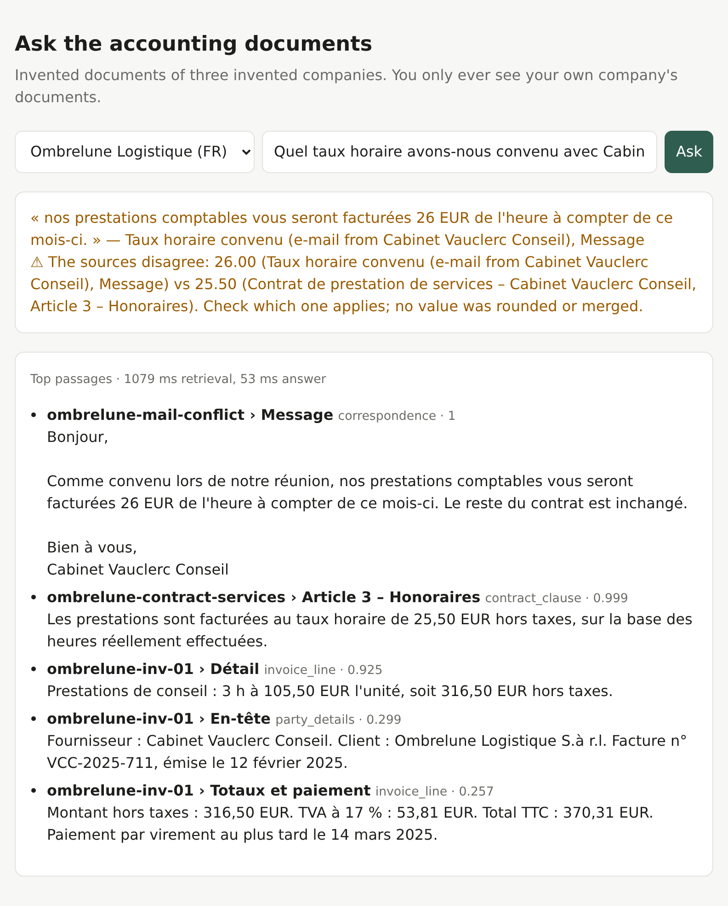
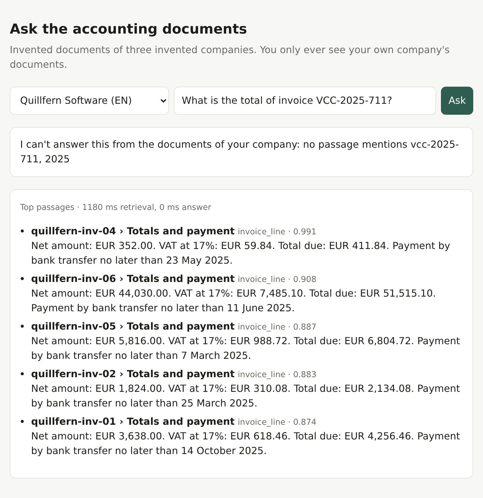
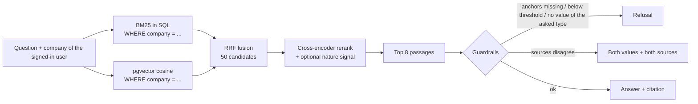

# RAG over accounting documents (FR / EN / DE)

[](https://github.com/NilsDavoine/rag-accounting-docs/actions/workflows/tests.yml)

**Try it with one command:** `make demo` (needs Docker and [uv](https://docs.astral.sh/uv/)). It
installs the pinned dependencies, starts PostgreSQL/pgvector, generates the invented documents,
builds the indexes and serves the page at http://localhost:8000.

<p>


</p>

A question-answering system over the documents of small companies: invoices, contracts,
tax letters, internal procedures and e-mails, in French, English and German. You ask
"What hourly rate did we agree with our accountant?" and get the answer, the source
document, or a refusal when the documents don't say. Left: the answer, its source, and the
warning that two sources disagree. Right: a question about another company's invoice, refused.

It is inspired by a production RAG I built for an accounting firm in Luxembourg. This
repository is new code on **invented** documents: no client, no real data, and no
production figures. It keeps the design choices that mattered in production, and it
comes with a benchmark that measures each of them.

## What it does

- **Hybrid search**: BM25 and vector search (PostgreSQL + pgvector), fused with
  Reciprocal Rank Fusion, then a multilingual cross-encoder reranks 50 candidates down
  to 8.
- **Section chunking with a context prefix**: each chunk starts with
  `[document title | company | date | section]`, so a line like
  "Total due: EUR 2,053.35" still says which invoice it belongs to.
- **Passage nature**: a small classifier labels each chunk (invoice line, contract
  clause, tax notice, procedure step, correspondence, party details). The label can be
  used as a ranking signal on top of the cross-encoder. Its effect is measured below,
  and on this corpus it doesn't help.
- **Tenant isolation inside the SQL query**: every query that returns passages has
  `WHERE company = %(company)s`. A test asks every bench question, plus every other
  company's document titles, as each company, and checks the owner of every returned
  passage.
- **Guardrails**:
  - **refuse** when no passage clears a relevance threshold;
  - **refuse** when the question asks for a kind of value (an amount, a date, an IBAN)
    that the passages don't contain;
  - **refuse** when an invoice number, year or quarter named in the question isn't in
    the passage;
  - **flag contradictions between sources** instead of picking or rounding one value.
    This one comes from a real failure: two documents said 25.5 and 26, and the
    production answer said "25";
  - **flag ambiguous dates** such as `04/03/2025`.

## Architecture



Indexing: documents are split at their section headings. Each chunk is classified by
nature, embedded with its context prefix, and stored with its company, its vector and
its BM25 postings (term, chunk, term frequency).

BM25 is the real Okapi BM25 (k1 = 1.2, b = 0.75), computed in SQL from the postings
table. Document frequency and average length are computed over the asking company's
chunks only. It is not PostgreSQL's `ts_rank`. A test checks that the SQL scores equal a
plain-Python reference implementation.

## Results

All numbers come from `python -m eval.run_eval`, which writes
[eval/results.md](eval/results.md) and copies the two tables below. Nothing here is typed
by hand.

The bench has 148 questions, 20 % of them without an answer. About a third (the dev
split) is used to tune three settings: the nature weight, the support threshold and the
conflict margin. The table below is on the other two thirds (the test split).

<!-- ablation:start -->
| Configuration | Recall@5 | MRR@8 | Answer accuracy | Refusal precision | Refusal recall | p50 latency | p95 latency |
|---|---|---|---|---|---|---|---|
| BM25 only | 66.5 % | 0.463 | 61.2 % | 45.7 % | 100.0 % | 108 ms | 193 ms |
| Vectors only (pgvector) | 97.0 % | 0.830 | 86.7 % | 76.2 % | 100.0 % | 133 ms | 230 ms |
| Hybrid: BM25 + vectors, RRF | 94.5 % | 0.682 | 82.7 % | 76.2 % | 100.0 % | 136 ms | 222 ms |
| + cross-encoder rerank | 100.0 % | 0.982 | 87.8 % | 80.0 % | 100.0 % | 1161 ms | 1351 ms |
| + passage-nature signal (weight 0.1, not tuned) | 100.0 % | 0.921 | 88.8 % | 80.0 % | 100.0 % | 1175 ms | 1322 ms |
<!-- ablation:end -->

How to read it:

- **BM25 alone is weak** because questions are often asked in another language than the
  document (a French question about a German invoice).
- **Vectors carry the cross-lingual cases.** On a corpus this small and regular, they
  already rank very well, and **RRF fusion is below vectors alone**, because the weak
  BM25 list pulls the fused ranking down. The production corpus had what this one
  lacks: exact references, product codes and thousands of near-duplicate documents,
  where lexical matching earns its place. On this corpus, the reranker recovers what
  fusion loses.
- **The passage-nature signal does not help here.** The tuning picked a weight of 0. A
  forced weight of 0.1 lowers MRR (0.982 to 0.921) and changes answer accuracy by one
  question out of 98, which is noise. Once the cross-encoder is near the ceiling, a type-level
  preference only reshuffles passages of the same type (one contract clause against
  another). It stays in the code as a measured option, not as a claimed gain.
- **Tenant isolation: 0 passages from another company** across every configuration and
  question (see [eval/results.md](eval/results.md)).

### Held-out hard set

The scores above are high because the documents and the questions come from the same
templates. So there is a second set, generated with another seed by
[data/generate_hard.py](data/generate_hard.py), and **never used to tune anything**: the
settings tuned on the main dev split are applied as they are. It has 27 other documents
for 3 other companies, made harder on purpose: line items in text tables (on some, the
currency appears only in the column header), heavier scan noise (`o` read as `0`, merged
and split words, line breaks inside sentences, a space slipped before the decimal
separator), long documents whose sections are near copies of each other (three payment
terms, two hourly rates, domestic and foreign expense ceilings), wording the main bench
never uses, and near-miss questions without an answer (a quarter the statement doesn't
cover, a service line the contract doesn't mention). 80 questions, 16 without an answer,
all reported.

<!-- hard:start -->
| Configuration | Recall@5 | MRR@8 | Answer accuracy | Refusal precision | Refusal recall | p50 latency | p95 latency |
|---|---|---|---|---|---|---|---|
| BM25 only | 68.8 % | 0.442 | 38.8 % | 26.5 % | 56.2 % | 156 ms | 313 ms |
| Vectors only (pgvector) | 95.3 % | 0.802 | 50.0 % | 40.9 % | 56.2 % | 213 ms | 410 ms |
| Hybrid: BM25 + vectors, RRF | 95.3 % | 0.734 | 50.0 % | 39.1 % | 56.2 % | 195 ms | 403 ms |
| + cross-encoder rerank | 96.9 % | 0.903 | 52.5 % | 40.0 % | 50.0 % | 1820 ms | 2050 ms |
| + passage-nature signal (weight 0.1, not tuned) | 96.9 % | 0.860 | 52.5 % | 38.1 % | 50.0 % | 1821 ms | 2067 ms |
<!-- hard:end -->

What it shows:

- **Retrieval generalises; the answer stage does not.** With the reranker, the right
  section is still in the top 5 for 96.9 % of the answerable questions, but answer accuracy
  falls from 87.8 % to 52.5 %. The breakdown in [eval/results.md](eval/results.md) shows
  where: 2 of 14 table-invoice questions are answered, 3 of 8 on the noisy VAT scan and 0 of 4
  on the e-mails, against 14 of 20 on the long framework agreement and 9 of 12 on the policy
  with near-identical sections. The value extractor only reads an amount that has its
  currency next to it, which table cells don't; and the extractive answerer takes the first
  value of the best clause, while both e-mails put two values of the same type in one sentence
  (the balance before the instalment, the old date before the new one).
- **Half of the unanswerable questions get an answer** (refusal recall 50 %, against 100 %
  on the main bench). The near misses are the hard part. Only 1 of 3 questions about a
  service line the contract doesn't cover is refused. The 3 questions about another
  company's invoice use number formats the identifier rule doesn't know (`GV/2025/0925`,
  `RE 2025.0870`, `CL20250694`), so no anchor can force the refusal, and only 1 of them is
  refused. None of them leaks a passage: the SQL filter still holds.
- **The passage-nature signal does not help on this set either.** A forced weight of 0.1
  lowers MRR (0.903 to 0.860) and leaves answer accuracy unchanged. The classifier trained
  on the main corpus labels 73.4 % of the hard set's chunks correctly, down from 83.1 %. On
  these invented corpora, passage classification does not improve answers, and this
  repository makes no claim that it does.
- **The next work is in the answer stage**, not in retrieval: reading tables, numbers that
  survive OCR damage, and choosing between two values in one sentence. That is where an LLM
  writer should help; the Claude path below is ready to measure it.
- **Tenant isolation holds**: 0 passages from another company on the hard set too.

## How the isolation test was checked

A test that has never failed proves nothing, so the isolation test was run against
deliberately broken code:

1. Removed the company filter from the vector query (`WHERE company = ... OR true`):
   the test failed, listing the foreign passages that Ombrelune received.
2. Removed the company filter from the BM25 query: the test failed.
3. Restored `rag/store.py` from a backup copy (checked by SHA-256): green again.

The test also has two positive controls. Each company must find its own documents, and
the probes must return more than 1,000 passages, so an empty result can't pass for
perfect isolation. The test never skips when the database is down: it fails.

## Run it

Requirements: Docker, [uv](https://docs.astral.sh/uv/), about 1 GB of disk for the two
models. A CPU is enough.

```bash
make demo         # everything below, then the web page at http://localhost:8000

make setup        # venv + pinned deps, PostgreSQL/pgvector in Docker, both corpora, both indexes
make test-fast    # unit tests and the fake-client tests of the Claude path: no database, no model
make test         # + the isolation tests (need the database and the index)
make eval         # benchmark on both sets -> eval/results.md (about 25 minutes on a laptop CPU)

.venv/bin/python -m app.cli --company ombrelune "Quel taux horaire avons-nous convenu avec Cabinet Vauclerc Conseil ?"
make web          # http://localhost:8000
```

GitHub Actions runs both test groups on every push: the fast tests, plus a check that the two
generators reproduce the committed corpora byte for byte; and the isolation tests against a
`pgvector/pgvector` service container with the real models (cached between runs).

Answer generation:

- **default: `extractive`**. It quotes the best clause with its source. It needs no
  model and no key, so the benchmark is deterministic.
- **`--generator ollama`**: a local model through Ollama (default
  `qwen2.5:1.5b-instruct`; set `OLLAMA_URL` and `OLLAMA_MODEL`).
- **`--generator anthropic`**: Claude (default `claude-haiku-5-5`), only if you set
  `ANTHROPIC_API_KEY`; another model can be set with `ANTHROPIC_MODEL`. If the passages
  don't hold the answer, the model replies `NO_ANSWER` and the app refuses.

### Measuring Claude

```bash
ANTHROPIC_API_KEY=... make eval-claude
```

This runs the app's configuration on the 98 test questions and the 80 hard questions with
Claude Haiku 5.5 writing the answers, and adds its rows to the "Answer generation" table of
[eval/results.md](eval/results.md). Before the first call it prints the number of requests
(only questions that pass the guardrails reach the model) and the estimated cost at
$0.10 / $0.50 per million input / output tokens, then asks for confirmation. The request
sends no `temperature`, `top_p`, `top_k` or assistant prefill, which current Claude models
reject. The whole path is tested with a fake client in
[tests/test_generation.py](tests/test_generation.py). Claude has **not** been measured yet:
it needs a paid key.

Checked by hand with `qwen3.5:4b` on CPU, about 7 s per answer. Asked for the agreed
hourly rate, the model wrote only "26 EUR". The deterministic conflict check then added
the 25.50 vs 26.00 warning with both sources, so the guardrail doesn't depend on the
model. The guardrails run the same way with every generator. Any number an LLM writes must
exist in the passages, or the answer falls back to the quote.

## Models

| Role | Model | Why |
|---|---|---|
| Embeddings | `intfloat/multilingual-e5-small` (118M, 384 dims) | multilingual, small enough for CPU, good retrieval quality for its size |
| Reranker | `cross-encoder/mmarco-mMiniLMv2-L12-H384-v1` (118M) | multilingual cross-encoder trained on mMARCO, runs on CPU |
| Nature classifier | TF-IDF (character 2–5-grams) + logistic regression | robust to OCR noise and FR/EN/DE morphology, trains in a second |

Both neural models are pinned to a Hugging Face commit hash in
[rag/config.py](rag/config.py). Python dependencies are pinned in
[requirements.txt](requirements.txt).

## Repository layout

```
data/generate_corpus.py   deterministic generator: 60 documents, nature labels, 148 questions
data/generate_hard.py     held-out hard set, another seed: 27 documents, 80 questions
data/corpus/, corpus_hard/  the generated documents (front-matter + text)
rag/                      chunking, BM25, store (SQL), retrieval, nature classifier, guardrails
eval/run_eval.py          benchmark and ablation on both sets  ->  eval/results.md
eval/run_generation.py    answer generators (extractive, Claude, Ollama) on the app's configuration
app/                      CLI and FastAPI page
docs/                     README screenshots and the script that takes them
tests/                    unit tests, fake-client tests (no model, no DB), isolation tests (real DB)
```

## The corpus

There are three invented companies: a French logistics firm, an English-speaking
software company and a German construction company. Each has invoices from seven
suppliers, a service agreement, an office lease, three tax letters from an invented tax
administration, two procedures and six e-mails. Scanned documents get simulated OCR
noise (lost accents, `l` read as `1`, `m` read as `rn`, broken hyphenation). Digits are
never damaged.

Deliberate traps:

- **conflicting numbers**: a contract says 25.50 EUR per hour, a later e-mail says 26.
  Notice period: 3 months against 2. Penalty: 0.5 % against 0.6 %;
- **an ambiguous date**: `04/03/2025` in an e-mail from a US supplier;
- **the same subject in all three companies**: the same invented building, the same
  quarter's VAT, the same procedures, with different numbers;
- **unanswerable questions**: values that appear nowhere (IBANs, phone numbers),
  periods that aren't covered, topics that don't exist, and **another company's invoice
  numbers**. Those last ones must be refused and must not leak.

## Honest limits

- **The corpus is synthetic and small**: 60 documents and 157 chunks, about 52 per
  company. 50 reranking candidates therefore cover almost a whole tenant. Templates
  make it more regular than real documents. Scores are much higher than they would be
  on a real archive. The value of this bench is the **comparison between
  configurations** and the guardrail checks, not the absolute numbers. The held-out hard
  set is invented too, by the same author as the code: it tests new templates and noise,
  not a real archive.
- **The questions come from the same generator as the documents.** They were written
  to vary wording and language, but they are not real user questions.
- **No PDF parsing or OCR**: documents are already text, and scans are simulated by
  injecting noise.
- **The extractive answerer quotes**: it doesn't write a sentence, and its accuracy is
  measured on the extracted value. The Claude path is ready and tested with a fake client,
  but Claude itself hasn't been measured: it needs a paid API key.
- **The support threshold is strict** (tau = 0.5, tuned on dev). Every unanswerable
  test question of the main bench is refused, but some answerable ones are too (refusal
  precision 80 %), mostly cross-lingual questions where the reranker is less confident. On
  the hard set the same threshold refuses only half of the unanswerable questions.
- **The reranker dominates latency**: about ten times the retrieval time on a laptop CPU
  (see the latency columns). A GPU or a smaller reranker would change that trade-off.
- **Rules where a model would be better**: question type (amount, date...) and the
  wanted passage nature are detected with multilingual keyword rules.
- **Conflict detection compares only the best-scoring clauses** (within a tuned
  margin). A contradiction buried in a low-ranked passage is not seen.
- **The company selector in the web page stands in for authentication.** In a real
  deployment the tenant comes from the signed-in user's session.

## How this was built

This is a public reconstruction of a system I designed and run in production for an
accounting firm in Luxembourg. The production code and data stay private, so this version
runs on invented data. I built it with Claude Code as a coding agent: I set the
architecture, the measurements and the acceptance criteria, and the agent wrote most of the
code to that brief. Every number in `results.md` is regenerated by a script, and each
guardrail is tested by breaking it on purpose.

## License

MIT, see [LICENSE](LICENSE). Third-party models keep their own licenses.
