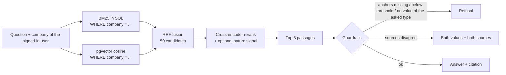

# RAG over accounting documents (FR / EN / DE)

A question-answering system over the documents of small companies: invoices, contracts,
tax letters, internal procedures and e-mails, in French, English and German. You ask
"What hourly rate did we agree with our accountant?" and get the answer, the source
document, or a refusal when the documents don't say.

It is inspired by a production RAG I built for an accounting firm in Luxembourg. This
repository is new code on **invented** documents: no client, no real data, and no
production figures. It keeps the design choices that mattered in production, and it
comes with a benchmark that measures each of them.

## What it does

- **Hybrid search**: BM25 and vector search (PostgreSQL + pgvector), fused with
  Reciprocal Rank Fusion, then a multilingual cross-encoder reranks 50 candidates down
  to 8.
- **Section chunking with a context prefix**: each chunk starts with
  `[document title | company | date | section]`, so a line like
  "Total due: EUR 2,053.35" still says which invoice it belongs to.
- **Passage nature**: a small classifier labels each chunk (invoice line, contract
  clause, tax notice, procedure step, correspondence, party details). The label can be
  used as a ranking signal on top of the cross-encoder. Its effect is measured below,
  and on this corpus it doesn't help.
- **Tenant isolation inside the SQL query**: every query that returns passages has
  `WHERE company = %(company)s`. A test asks every bench question, plus every other
  company's document titles, as each company, and checks the owner of every returned
  passage.
- **Guardrails**:
  - **refuse** when no passage clears a relevance threshold;
  - **refuse** when the question asks for a kind of value (an amount, a date, an IBAN)
    that the passages don't contain;
  - **refuse** when an invoice number, year or quarter named in the question isn't in
    the passage;
  - **flag contradictions between sources** instead of picking or rounding one value.
    This one comes from a real failure: two documents said 25.5 and 26, and the
    production answer said "25";
  - **flag ambiguous dates** such as `04/03/2025`.

## Architecture



Indexing: documents are split at their section headings. Each chunk is classified by
nature, embedded with its context prefix, and stored with its company, its vector and
its BM25 postings (term, chunk, term frequency).

BM25 is the real Okapi BM25 (k1 = 1.2, b = 0.75), computed in SQL from the postings
table. Document frequency and average length are computed over the asking company's
chunks only. It is not PostgreSQL's `ts_rank`. A test checks that the SQL scores equal a
plain-Python reference implementation.

## Results

All numbers come from `python -m eval.run_eval`, which writes
[eval/results.md](eval/results.md) and copies the table below. Nothing here is typed
by hand.

The bench has 148 questions, 20 % of them without an answer. About a third (the dev
split) is used to tune three settings: the nature weight, the support threshold and the
conflict margin. The table below is on the other two thirds (the test split).

<!-- ablation:start -->
| Configuration | Recall@5 | MRR@8 | Answer accuracy | Refusal precision | Refusal recall | p50 latency | p95 latency |
|---|---|---|---|---|---|---|---|
| BM25 only | 66.5 % | 0.463 | 61.2 % | 45.7 % | 100.0 % | 191 ms | 408 ms |
| Vectors only (pgvector) | 97.0 % | 0.830 | 86.7 % | 76.2 % | 100.0 % | 244 ms | 423 ms |
| Hybrid: BM25 + vectors, RRF | 94.5 % | 0.682 | 82.7 % | 76.2 % | 100.0 % | 242 ms | 437 ms |
| + cross-encoder rerank | 100.0 % | 0.982 | 87.8 % | 80.0 % | 100.0 % | 2631 ms | 4648 ms |
| + passage-nature signal (weight 0.1, not tuned) | 100.0 % | 0.921 | 88.8 % | 80.0 % | 100.0 % | 2789 ms | 7252 ms |
<!-- ablation:end -->

How to read it:

- **BM25 alone is weak** because questions are often asked in another language than the
  document (a French question about a German invoice).
- **Vectors carry the cross-lingual cases.** On a corpus this small and regular, they
  already rank very well, and **RRF fusion is below vectors alone**, because the weak
  BM25 list pulls the fused ranking down. The production corpus had what this one
  lacks: exact references, product codes and thousands of near-duplicate documents,
  where lexical matching earns its place. On this corpus, the reranker recovers what
  fusion loses.
- **The passage-nature signal does not help here.** The tuning picked a weight of 0. A
  forced weight of 0.1 lowers MRR (0.982 to 0.921) and changes answer accuracy by one
  question out of 98, which is noise. Once the cross-encoder is near the ceiling, a type-level
  preference only reshuffles passages of the same type (one contract clause against
  another). It stays in the code as a measured option, not as a claimed gain.
- **Tenant isolation: 0 passages from another company** across every configuration and
  question (see [eval/results.md](eval/results.md)).

## How the isolation test was checked

A test that has never failed proves nothing, so the isolation test was run against
deliberately broken code:

1. Removed the company filter from the vector query (`WHERE company = ... OR true`):
   the test failed, listing the foreign passages that Ombrelune received.
2. Removed the company filter from the BM25 query: the test failed.
3. Restored `rag/store.py` from a backup copy (checked by SHA-256): green again.

The test also has two positive controls. Each company must find its own documents, and
the probes must return more than 1,000 passages, so an empty result can't pass for
perfect isolation. The test never skips when the database is down: it fails.

## Run it

Requirements: Docker, [uv](https://docs.astral.sh/uv/), about 1 GB of disk for the two
models. A CPU is enough.

```bash
make setup        # venv + pinned deps, PostgreSQL/pgvector in Docker, corpus, index
make test         # unit tests + isolation tests (needs the database)
make eval         # benchmark -> eval/results.md (about 10 minutes on a laptop CPU)

.venv/bin/python -m app.cli --company ombrelune "Quel taux horaire avons-nous convenu avec Cabinet Vauclerc Conseil ?"
make web          # http://localhost:8000
```

Answer generation:

- **default: `extractive`**. It quotes the best clause with its source. It needs no
  model and no key, so the benchmark is deterministic.
- **`--generator ollama`**: a local model through Ollama (default
  `qwen2.5:1.5b-instruct`; set `OLLAMA_URL` and `OLLAMA_MODEL`).
- **`--generator anthropic`**: Claude, only if you set `ANTHROPIC_API_KEY`; the model
  is set with `ANTHROPIC_MODEL`.

Checked by hand with `qwen3.5:4b` on CPU, about 7 s per answer. Asked for the agreed
hourly rate, the model wrote only "26 EUR". The deterministic conflict check then added
the 25.50 vs 26.00 warning with both sources, so the guardrail doesn't depend on the
model. The guardrails run the same way with every generator. Any number an LLM writes must
exist in the passages, or the answer falls back to the quote.

## Models

| Role | Model | Why |
|---|---|---|
| Embeddings | `intfloat/multilingual-e5-small` (118M, 384 dims) | multilingual, small enough for CPU, good retrieval quality for its size |
| Reranker | `cross-encoder/mmarco-mMiniLMv2-L12-H384-v1` (118M) | multilingual cross-encoder trained on mMARCO, runs on CPU |
| Nature classifier | TF-IDF (character 2–5-grams) + logistic regression | robust to OCR noise and FR/EN/DE morphology, trains in a second |

Both neural models are pinned to a Hugging Face commit hash in
[rag/config.py](rag/config.py). Python dependencies are pinned in
[requirements.txt](requirements.txt).

## Repository layout

```
data/generate_corpus.py   deterministic generator: 60 documents, nature labels, 148 questions
data/corpus/              the generated documents (front-matter + text)
rag/                      chunking, BM25, store (SQL), retrieval, nature classifier, guardrails
eval/run_eval.py          benchmark and ablation  ->  eval/results.md
app/                      CLI and FastAPI page
tests/                    unit tests (no model, no DB) and isolation tests (real DB)
```

## The corpus

There are three invented companies: a French logistics firm, an English-speaking
software company and a German construction company. Each has invoices from seven
suppliers, a service agreement, an office lease, three tax letters from an invented tax
administration, two procedures and six e-mails. Scanned documents get simulated OCR
noise (lost accents, `l` read as `1`, `m` read as `rn`, broken hyphenation). Digits are
never damaged.

Deliberate traps:

- **conflicting numbers**: a contract says 25.50 EUR per hour, a later e-mail says 26.
  Notice period: 3 months against 2. Penalty: 0.5 % against 0.6 %;
- **an ambiguous date**: `04/03/2025` in an e-mail from a US supplier;
- **the same subject in all three companies**: the same invented building, the same
  quarter's VAT, the same procedures, with different numbers;
- **unanswerable questions**: values that appear nowhere (IBANs, phone numbers),
  periods that aren't covered, topics that don't exist, and **another company's invoice
  numbers**. Those last ones must be refused and must not leak.

## Honest limits

- **The corpus is synthetic and small**: 60 documents and 157 chunks, about 52 per
  company. 50 reranking candidates therefore cover almost a whole tenant. Templates
  make it more regular than real documents. Scores are much higher than they would be
  on a real archive. The value of this bench is the **comparison between
  configurations** and the guardrail checks, not the absolute numbers.
- **The questions come from the same generator as the documents.** They were written
  to vary wording and language, but they are not real user questions.
- **No PDF parsing or OCR**: documents are already text, and scans are simulated by
  injecting noise.
- **The extractive answerer quotes**: it doesn't write a sentence, and its accuracy is
  measured on the extracted value. Accuracy with an LLM generator hasn't been measured
  here.
- **The support threshold is strict** (tau = 0.5, tuned on dev). Every unanswerable
  test question is refused, but some answerable ones are too (refusal precision 80 %),
  mostly cross-lingual questions where the reranker is less confident.
- **The reranker dominates latency**: 2.6 s at the median on a laptop CPU, against
  0.25 s without it. A GPU or a smaller reranker would change that trade-off.
- **Rules where a model would be better**: question type (amount, date...) and the
  wanted passage nature are detected with multilingual keyword rules.
- **Conflict detection compares only the best-scoring clauses** (within a tuned
  margin). A contradiction buried in a low-ranked passage is not seen.
- **The company selector in the web page stands in for authentication.** In a real
  deployment the tenant comes from the signed-in user's session.

## License

MIT, see [LICENSE](LICENSE). Third-party models keep their own licenses.
